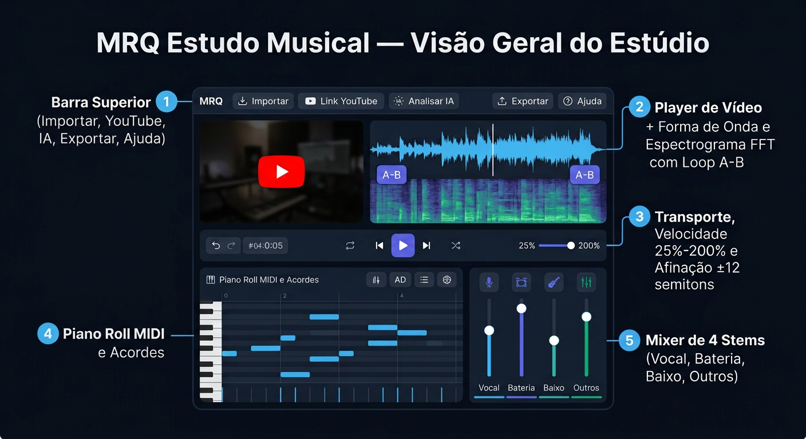
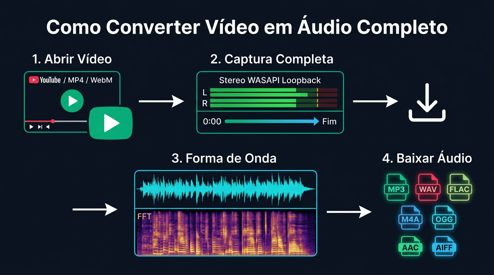
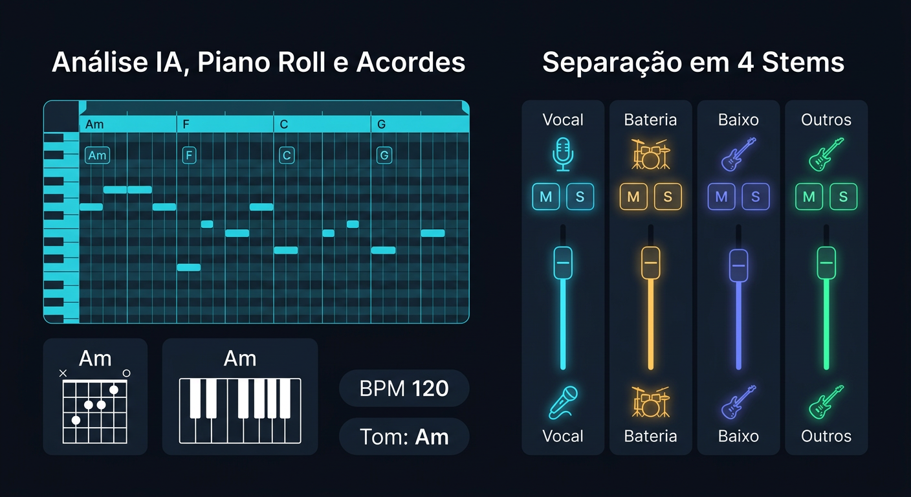
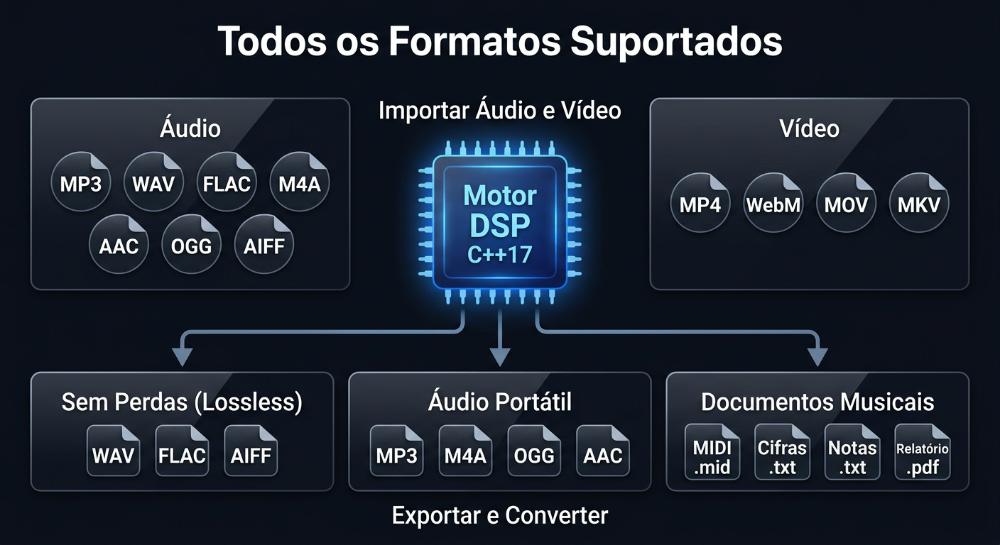

# Manual do Usuário — MRQ Estudo Musical

Guia completo com texto e imagens explicando **como o programa inteiro funciona**, **como converter qualquer vídeo em áudio completo de forma fácil** e **todos os formatos suportados**.

---

## 1. Visão Geral do Estúdio

1. **Barra Superior (`①`)**:
   - **Link Vídeo / YT**: cola links do YouTube (`youtube.com`, `youtu.be`, `shorts`, `live`) ou links diretos de vídeo/áudio (`.mp4`, `.webm`, `.mov`, `.mp3`, `.wav`).
   - **Áudio / Vídeo**: importa arquivos locais (ou arraste e solte direto na janela).
   - **Analisar IA**: detecta BPM, batidas, compasso, tonalidade, acordes e notas polifônicas.
   - **Exportar**: converte e baixa o áudio em **7 formatos** (`MP3, WAV, FLAC, M4A, OGG, AAC, AIFF`) ou gera **MIDI, Notas TXT, Cifras TXT e Relatório PDF**.
   - **Ajuda**: abre a Central de Ajuda Visual dentro do próprio aplicativo (também acessível pela tecla `?`).
2. **Palco Central (`②`)**: exibe o player de vídeo sincronizado + **Forma de Onda** de alta resolução + **Espectrograma FFT** (linear/logarítmico). Arraste com o mouse sobre a onda para criar um **Loop A → B** e use `+ / − / 0` para zoom.
3. **Transporte, Velocidade & Afinação (`③`)**:
   - **Velocidade (25% a 200%)** sem alterar o tom (Phase Vocoder C++17 com travamento de fase).
   - **Afinação & Transposição**: ±12 semitons, oitavas e ajuste fino em cents (±100¢) independente da velocidade.
   - **Pré-contagem** (0,5s a 5s com metrônomo), **Tap Tempo (`T`)**, **Marcas (`M`)** e **Batidas (`B`)**.
4. **Piano Roll & Acordes (`④`)**: transcrição interativa com edição manual, síntese sonora de preview, diagramas de Violão/Guitarra e Teclado sincronizados.
5. **Mixer de 4 Stems (`⑤`)**: separa **Vocal**, **Bateria**, **Baixo** e **Outros** com controles individuais de Volume, **Mute (M)** e **Solo (S)** — ideal para tirar solos ou criar playbacks/karaokês.

---

## 2. Como Converter o Vídeo Inteiro para Áudio Completo (Passo a Passo)

### Opção A — Vídeo do YouTube (Captura Completa Automática `0:00 → Fim`)
1. Clique em **Link Vídeo / YT** e cole o link (por exemplo: `https://youtu.be/aNOyvBm9Gfw?si=btcuTvTbN0Z4j8YW`).
2. No topo do vídeo, clique no botão verde **Capturar Som do Sistema**.
3. Em **1. Fonte do Áudio**, deixe selecionado **Som do Sistema (Saída / Placa)** — no Windows usa **WASAPI Loopback Estéreo** nativo (não depende de microfone e grava exatamente o som estéreo do computador sem silenciar os alto-falantes).
4. Em **2. Formato para Converter**, escolha o formato final desejado (**MP3, WAV, FLAC, M4A, OGG, AAC ou AIFF**).
5. Clique em **Capturar Vídeo Completo (0:00 → Fim)**:
   - O MRQ volta o vídeo automaticamente para `0:00`, coloca velocidade `100%` e inicia o vídeo;
   - As barras verdes **L / R** e a barra de progresso mostram o sinal estéreo em tempo real;
   - **Ao final do vídeo, a captura para automaticamente**, gera a **Forma de Onda + Espectrograma FFT** completa e já faz o download do áudio convertido no formato escolhido!
6. A qualquer momento depois, você pode usar a faixa **Baixar Áudio Atual** (`MP3 | WAV | FLAC | M4A | OGG | AAC | AIFF`) para converter novamente em outros formatos em 1 clique!

> **Conformidade legal:** o MRQ utiliza exclusivamente a API oficial do YouTube IFrame Player aliada à captura de saída local do sistema operacional (sem download não autorizado de streams).

### Opção B — Vídeo Local (`.MP4`, `.WebM`, `.MOV`, `.MKV`, `.M4V`) ou Link Direto
1. Arraste seu arquivo de vídeo para dentro do MRQ (ou clique em **Áudio / Vídeo**).
2. O motor nativo FFmpeg extrai imediatamente o áudio completo, exibindo o vídeo sincronizado à Forma de Onda.
3. No cabeçalho do vídeo, escolha o formato (`MP3, WAV, FLAC, M4A, OGG, AAC ou AIFF`) e clique em **Converter Vídeo → [Formato]** para baixar o áudio inteiro em 1 clique!

---

## 3. Análise IA, Piano Roll, Acordes e Separação em 4 Stems

- **Analisar IA**: detecta BPM, batidas, tonalidade/escala, progressão de acordes e notas polifônicas 100% offline.
- **Piano Roll & MIDI**: clique nas notas para ouvir, arraste para editar tempos/alturas, quantize ou exporte como `.mid`.
- **Notas & Acordes**: visualize o acorde tocado em tempo real no diagrama de **Violão/Guitarra** e **Teclado**, edite cifras e exporte em `.txt` ou `.pdf`.
- **Separação em 4 Stems**: separe **Vocal, Bateria, Baixo e Outros**, ative o mixer em tempo real, silencie o vocal para estudar cantando/tocando junto (Karaokê/Playback) e exporte qualquer stem isolado ou o mix personalizado com velocidade e tom aplicados!

---

## 4. Todos os Formatos Suportados (Importação & Exportação)

### 11 Formatos de Exportação e Conversão (Saída)

| Formato | Categoria | Qualidade / Padrão | Melhor uso |
|---|---|---|---|
| **`.MP3`** | Áudio Portátil | 192 kbps Estéreo (`libmp3lame`) | Universal: celular, WhatsApp, estudo portátil |
| **`.M4A`** | Áudio Portátil | AAC 192 kbps (`ipod/mp4`) | iPhone, iPad, Mac, Android com ótima eficiência |
| **`.OGG`** | Áudio Portátil | Opus 48 kHz / 192 kbps | Arquivo ultraleve com altíssima fidelidade |
| **`.AAC`** | Áudio Portátil | ADTS 192 kbps | Streaming leve e envio rápido |
| **`.WAV`** | Sem Perdas (Lossless) | PCM 16-bit Estéreo | Edição em DAWs (Reaper, Ableton, Cubase, FL Studio) |
| **`.FLAC`** | Sem Perdas (Lossless) | FLAC Lossless | Qualidade de estúdio ocupando ~50% menos espaço que WAV |
| **`.AIFF`** | Sem Perdas (Lossless) | PCM 16-bit Big-Endian | Padrão Apple, Logic Pro, GarageBand e Pro Tools |
| **`.MID`** | Transcrição Musical | Standard MIDI File Type 1 | Importar notas do Piano Roll em DAWs, MuseScore ou Guitar Pro |
| **Notas `.TXT`** | Transcrição Musical | Texto UTF-8 | Tabela completa com tempos, nota, MIDI, velocidade e papel |
| **Cifras `.TXT`** | Transcrição Musical | Texto UTF-8 | Folha de cifras com progressão harmônica, marcadores, loops e link |
| **Relatório `.PDF`** | Documento Completo | PDF A4 (ReportLab) | Impressão/tablet: resumo completo do estudo (BPM, Tom, Loops, Cifras, Notas) |

### 12 Formatos de Importação (Entrada)

| Tipo | Formatos aceitos |
|---|---|
| **Áudio** | `.mp3`, `.wav`, `.flac`, `.m4a`, `.aac`, `.ogg`, `.aiff`, `.aif` |
| **Vídeo Local & Link Direto** | `.mp4`, `.webm`, `.mov`, `.mkv`, `.m4v` (vídeo sincronizado + extração completa de áudio) |
| **YouTube Online** | Links `youtube.com/watch?v=...`, `youtu.be/...`, `shorts`, `live`, `embed` ou ID de 11 caracteres |

### 5 Escopos de Exportação de Áudio (disponíveis nos 7 formatos)
1. **Música / Vídeo Completo** — converte a faixa inteira.
2. **Loop A → B Ativo** — converte somente a frase selecionada.
3. **Seleção Personalizada** — defina manualmente tempo inicial e final.
4. **Stem Individual** — exporta somente Vocal, Bateria, Baixo ou Outros.
5. **Mix de Stems (Karaokê / Playback)** — exporta sua mixagem personalizada com volumes, mutes, velocidade e afinação aplicados.

---

## 5. Atalhos de Teclado Essenciais

| Tecla | Ação |
|---|---|
| `Espaço` | Reproduzir / Pausar |
| `←` / `→` | Voltar / Avançar 5 segundos |
| `L` | Ativar / Desativar Loop A/B |
| `A` / `]` | Definir Ponto A / Ponto B do Loop |
| `B` | Marcar Batida (calcula BPM automaticamente) |
| `M` | Criar Marcador de seção na posição atual |
| `T` | Tap Tempo |
| `Ctrl + Scroll` | **Zoom Horizontal** (centralizado no cursor) na Forma de Onda, Linha do Tempo e Vídeo |
| `Shift + Scroll` ou `Alt + Scroll` | **Zoom Vertical** (altura + ganho da Forma de Onda, Linha do Tempo e Vídeo) |
| `Ctrl + Shift + Scroll` | **Zoom Horizontal + Vertical juntos** (Proporcional) |
| `Scroll do Mouse` (modos `Zoom H` / `Zoom V` / `Mover`) | Zoom ou Enquadramento direto com **1 mão só** na Forma de Onda e no Vídeo |
| `+` / `−` / `0` | Zoom + / Zoom − / Ajustar à música inteira |
| `Ctrl+Shift+Y` | Abrir Link de Vídeo / YouTube |
| `Ctrl+S` | Salvar projeto imediatamente |
| `Ctrl+Z` / `Ctrl+Y` | Desfazer / Refazer no Piano Roll e Acordes |
| `?` | Abrir a Central de Ajuda |
